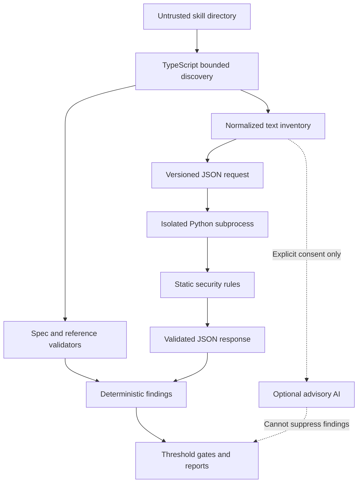

# Architecture

Approved hybrid design: TypeScript CLI/core and Python static security engine,
communicating through locally validated versioned JSON. Basic checks must not need
Python. Optional AI stays off until explicit consent, disclosure and budgets exist.

This diagram includes planned modules, not an implementation claim. Actual status
is in IMPLEMENTATION_TRACKER and phase reports. Runtime authority is intentionally
split: filesystem policy belongs to TypeScript; Python consumes text data only.
Neither layer executes scanned scripts. The subprocess is not an OS sandbox.

Canonical contracts: packages/protocol/schema. Rule IDs and taxonomy are public
contracts when released. Identity strings live in CLI core/identity.ts; package
manifests, Python metadata and protocol URNs are independently versioned build
metadata, not external service addresses. Package names remain private/provisional.

See ADR 0001 for language choice, ADR 0002 for the protocol trust boundary,
THREAT_MODEL for adversaries and residual risks, and PROTOCOL for wire limits.
